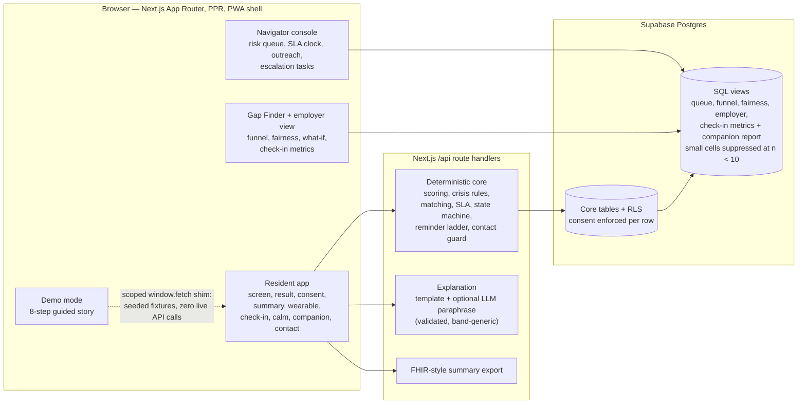

# JISR — a bridge from screening to real human support

Prototype for the Future Health Digital Innovation Challenge, **Wellbeing Challenge 10: Earlier, Safer Mental Wellbeing Support**.

JISR screens residents with PHQ-9 / GAD-7 in English, Arabic (RTL) and Hindi, explains results in plain language, matches a stepped local support option, and hands every case to a **human navigator** with SLA clocks and an overdue queue. A health-system Gap Finder shows where the pathway fails by language, age, area and nationality, with small-cell suppression and consent-filtered aggregates. A **Check-in Companion** adds resident-controlled reminders, a bounded persistence ladder, an offline Calm Corner, a scripted (no-LLM) check-in companion and an opt-in trusted contact — every step consent-gated, audited and fed back into the Gap Finder.

- **Live production:** https://jisr-gamma.vercel.app
- **Requirements map and honest limitations in the app:** `/about`
- **All data is synthetic.** Every page carries a visible "Prototype — synthetic data" badge and an honest footer.

## What is in the box

| Layer | Capability |
| --- | --- |
| 1 | Deterministic PHQ-9 / GAD-7 scoring, fixed-rule crisis detection, stepped support matching, state machine, SLA milestones, navigator queue + simulated clock, outreach log |
| 2 | Consent ledger (7 scopes, default-off, audit trail) enforced by Postgres RLS; employer view (anonymous aggregates only); Gap Finder funnel + fairness views with `n >= 10` suppression inside SQL; simulated what-if panel |
| 3 | i18n en / ar (RTL) / hi; optional LLM plain-language explanation with deterministic template fallback and output validation; primary-care summary + FHIR-style export; deterministic wearable simulator |
| 4 | Guided **Demo mode** on seeded fixtures (zero live API calls), `/about` requirements map, installable **PWA** with offline app shell, per-page metadata, polish sweep, this README |
| 5 | **Check-in Companion**: resident-set reminders (schedule, quiet hours, snooze, daily cap) + in-app notification center; bounded persistence ladder into the navigator queue; offline **Calm Corner** (box breathing, 5-4-3-2-1 grounding, memory match) with DB-stored, faculty-reviewable lines; scripted no-LLM companion with local crisis scan; opt-in **trusted contact** with a simulated generic message; full audit log; Gap Finder check-in metrics, fairness and aggregate companion report |

## Setup

Prerequisites: Node.js 20+, a Postgres database (Supabase free tier works), npm.

```bash
git clone https://github.com/Sri-Charan-3-1-6/JiSR.git
cd JiSR
npm install

# .env.local — never commit this file
#   DATABASE_URL=postgres://...        (required; Supabase pooler or direct URL)
#   OPENROUTER_API_KEY=...             (optional; LLM paraphrase only, template fallback without it)

npm run db:migrate     # applies db/migrations/001…016 in order against DATABASE_URL
npm run dev            # http://localhost:3000
```

Production build and serve:

```bash
npm run build
npm run start
```

The service worker registers only in production builds. Keys are read from environment variables only and are never printed or logged.

## Architecture



Rules that never bend: the LLM **never** scores, matches, decides crisis or diagnoses — it only rephrases an already-deterministic band explanation, and every output is validated before display. Crisis routing is fixed code (`src/lib/crisis.ts`). Emergency numbers live in `src/config/emergency.ts` as placeholders marked "VERIFY WITH ABU DHABI DEPARTMENT OF HEALTH BEFORE DEMO".

## Database migrations

Applied in order by `npm run db:migrate` (`scripts/migrate.mjs`). All seeds are synthetic and fixed-seed for repeatability.

| File | Purpose |
| --- | --- |
| `001_schema.sql` | Core schema: residents, screenings, cases, events, outreach, consent scopes + audit, wearable signals, simulated clock |
| `002_seed_synthetic.sql` | Layer 1 seed: 8 pseudonymous demo residents and cases |
| `003_views.sql` | SLA status, overdue detection and navigator queue views, evaluated against `sim_now()` |
| `004_rls.sql` | Row-level security enforcing consent scopes; `jisr_app` / `jisr_employer` test roles |
| `005_gapfinder_views.sql` | Gap Finder metrics + fairness views; medians via `percentile_cont`; `HAVING COUNT(*) >= 10` suppression inside the views |
| `006_seed_gapfinder.sql` | ~2000-resident synthetic dataset with deliberately injected language/area gaps |
| `007_funnel_fix.sql` | Booked-to-attended divides by all booked cases; booking-conversion gap flags |
| `008_role_membership.sql` | Grants letting the app role `SET ROLE` to consent-bound test roles on Supabase |
| `009_consent_views.sql` | Aggregates count only residents with `anonymous_aggregate_stats` ON; revocation is immediate |
| `010_seed_small_group.sql` | 7-person nationality group ("Group S") so suppression is visible live |
| `011_seed_layer3.sql` | Synthetic primary-care flags and deterministic 21-day wearable series |
| `012_explanation_cache.sql` | Band-generic explanation cache keyed by (instrument, band, language) — no resident data |
| `013_layer5_schema.sql` | Check-in companion schema: checkins, reminder prefs + events, navigator escalation tasks, trusted contacts + contact events, calm lines (with `reviewed` flag) + sessions, companion sessions + prefs; adds `reminders` and `trusted_contact` consent scopes |
| `014_layer5_rls.sql` | RLS for every Layer 5 table: reminders/trusted_contact scopes gate their rows; calm lines are public content; employer role denied all base tables |
| `015_layer5_views.sql` | Gap Finder check-in metrics (completion rate, median hours to re-engage, human-resolved escalation share), per-dimension fairness with `n >= 10` suppression, and an aggregate-only companion report |
| `016_seed_layer5.sql` | Synthetic check-ins, reminder events, escalation tasks, calm lines in en/ar/hi and companion sessions feeding the new views |

## Tests

```bash
npm test                                  # 245 vitest tests (unit + real-Postgres integration)
npx playwright install chromium           # once, for e2e
npx playwright test                       # all e2e specs against http://localhost:3000
E2E_BASE_URL=https://<preview>.vercel.app npx playwright test   # against a deployed preview
```

- `tests/` — scoring, crisis rules, matching, SLA, consent/RLS integration, small-cell suppression, LLM guards, demo store, i18n key parity, and Layer 5: reminder quiet-hours/cap/ladder bounds, trusted-contact message guard, companion crisis scan, calm-line review, and a **no-camera ban** (`tests/no-camera.test.ts` greps the source for `getUserMedia` / face-analysis and fails if found). Integration tests run against the real `DATABASE_URL`; they never mock Postgres.
- `e2e/interactions.pw.ts` — resident screening → result → accept, navigator contact, consent toggle, what-if.
- `e2e/layer5.pw.ts` — live golden path: quiet-hours skip, reminder + mark read, snooze, complete, ladder escalation to a navigator task, failed call → simulated generic trusted-contact message (asserted free of health wording) → reply as "contact made", calm breathing + opt-in jokes, companion crisis keyword → `/emergency`, and reminders revocation emptying the center; zero console errors.
- `e2e/demo.pw.ts` — the full 8-step demo story at 390px and 1440px; asserts **zero `/api/` network requests and zero console errors**; writes per-step screenshots to `docs/screenshots/demo/`.
- `e2e/pwa.pw.ts` — manifest, icon dimensions, service-worker control, offline app-shell reload and offline demo run.
- `e2e/sweep.pw.ts` — every id-free route (including check-in, calm, companion and trusted-contact): page title, synthetic badge, honest footer, zero console errors.
- `e2e/screenshots.pw.ts` — portal screenshots for docs.

Lighthouse reports (mobile, deployed production) are in `docs/lighthouse/`; gates are performance ≥ 85 and accessibility ≥ 95.

## How Demo mode works

The **Demo mode** button on the home page starts a seeded story: a young Hindi-speaking worker screens PHQ-9 → moderate result with plain-language explanation → matched support step → missed follow-up → the navigator's Overdue queue catches the case at day 12 → navigator logs a call → Gap Finder shows the language gap → the check-in companion's notification center and bounded ladder → a trusted contact receives one simulated generic message after the human call fails. A fixed overlay guides it ("Step 1 of 8", Back / Next / Reset demo).

Mechanics (`src/components/demo/demo-provider.tsx`, `src/lib/demo/story.ts`):

1. While the demo is active, the provider installs a **scoped `window.fetch` shim**. Every `/api/*` request is answered by the pure, unit-tested `handleDemoRequest(path, init, store)` from an in-memory seeded store — scoring, SLA, queue, outreach, consent and Gap Finder responses included. Non-API requests pass through untouched.
2. Because the shim sits in front of the network, the story makes **zero live API calls** by construction; the e2e suite asserts this by recording every request.
3. Routes outside the story answer `503` with an honest "not part of the demo story" message instead of leaking live data.
4. **Reset demo** restores the original `fetch`, restores the previous `localStorage` resident id, and returns home. The shim is also removed on unmount.
5. The same fixtures power the offline PWA run: after one online visit, the service worker has cached the shell, page chunks and RSC payloads, so the whole story runs with the network disabled.

## Installable PWA

- `public/manifest.webmanifest`: standalone display, theme/background colors, 192px and 512px icons plus a 512px maskable icon and an apple-touch icon (rasterized from the JISR logo by `scripts/make-icons.mjs`).
- `public/sw.js`: precaches the app shell and the demo story's RSC payloads at install; network-first with cache fallback for navigations and RSC requests; cache-first for `/_next/static/` and icons; **never caches `/api/`**.
- Offline scope: after one online visit, the shell and the demo story load and run offline. A first-ever load with no network is not supported (basic service worker, by design).
- Installability is verified in headless Chromium (manifest, icons, SW control, offline reload + offline demo) by `e2e/pwa.pw.ts`. It has **not** been verified on a physical Android Chrome device yet.

## Check-in Companion (Layer 5)

Everything here is opt-in, granular and revocable in the consent ledger (`reminders`, `trusted_contact`); revoking stops the relevant flow immediately. No camera, no facial analysis, no covert monitoring, and nothing forces a form to be completed.

- **Reminders** (`src/lib/reminders.ts`, `/resident/checkin`): the resident sets their own time, quiet hours, snooze length and a maximum reminders per day. An in-app notification center lists every event with read/unread state. The Vibration API is optional, foreground-only and off by default. Real Web Push is **not** implemented (deferred optional extra). Reminder times, quiet hours and the daily cap are evaluated on a fixed UTC basis, independent of server or device timezone.
- **Gentle persistence ladder**: one reminder, then one soft second reminder after a configurable gap, then after N consecutive misses a task in the navigator queue (a human call). The ladder is bounded — at most 3 sends per check-in, then it always stops; it never loops endlessly. Quiet hours and the daily cap skip sends without marking misses.
- **Calm Corner** (`/resident/calm`): box breathing (animated circle), 5-4-3-2-1 grounding and memory match, all running offline. Supportive lines are pre-written, stored per language (en/ar/hi) in `calm_lines` with a `reviewed` flag faculty can toggle in the health-system portal — never AI-generated, no toxic positivity, no lines telling users how they should feel. Jokes/memes are an opt-in setting, off by default.
- **Guided companion** (`src/lib/companion.ts`, `/resident/companion`): a scripted decision tree, no LLM, no free text sent to any external model. Free text is scanned locally by the same fixed crisis rules as screening; a match opens `/emergency` and creates a CRITICAL navigator case. Sessions are capped at 8 steps, show "I'm not a replacement for a professional" and a one-tap "talk to a human" button. A simple self-reported mood tag is stored but shown **only** in aggregate Gap Finder reports, never to the resident.
- **Trusted contact** (`src/lib/trusted-contact.ts`, `/resident/trusted-contact`): opt-in. Only after the navigator's human call fails (`not_reached`, unresolved) can one generic message be sent: "[Name] asked us to let you know they'd appreciate a call." A `containsHealthData` guard blocks any health wording before the simulated send. Sending is simulated (no real WhatsApp API) with a "Simulated" badge and a prefilled `wa.me` link. A reply is recorded only as "contact made" — it never marks the person as well or changes the risk level.
- **Audit + integration**: every reminder, escalation and contact step appears in the resident's audit log. All Layer 5 events feed SQL views (`gapfinder_checkin_metrics`, `gapfinder_checkin_fairness`, `gapfinder_companion_report`) surfaced as health-system cards: check-in completion rate, median time to re-engage after a miss, and share of escalations resolved by a human — split by language, age band, gender, nationality and area with the same fairness flags and `<10` suppression. Every Layer 5 screen links to the Follow-up Clock and the Gap Finder.

## Limitations and honest claims

- **Synthetic data only.** Residents, cases, aggregates and wearable series are seeded fixtures; the badge and footer say so on every page.
- **No authentication.** Residents are pseudonymous ids in `localStorage`; there are no names, no ID numbers, no login. DB roles model consent boundaries in tests, not a production auth system.
- **No clinical validation.** Scoring implements standard PHQ-9 / GAD-7 cut-offs, but nothing here is a validated clinical device. Every result screen states what the score means *and* "This is a screening, not a diagnosis."
- **No real hospital integration.** The FHIR-style export is a demonstration payload. JISR is built to plug into hospital systems later; no integration is claimed today.
- **Simulated wearable.** Deterministic synthetic series, no device SDK, no real sensor data.
- **Simulated what-if.** The intervention panel is arithmetic over synthetic aggregates, not a causal or predictive model.
- **Simulated clock.** Navigator time-travel exists to demonstrate SLA breaches; there is no real scheduling infrastructure.
- **Emergency numbers are real but must be re-verified.** `src/config/emergency.ts` carries the Abu Dhabi numbers taken from official sources on 21 Nov 2026 (ambulance 998, police 999, Istijaba 800 1717, 800-HOPE 800 4673, Sakina 800 725462), shown as tap-to-call links in en/ar/hi. Re-verify with the Abu Dhabi Department of Health before any real deployment.
- **LLM is optional and fenced.** Without `OPENROUTER_API_KEY` (or on any validation failure) explanations fall back to deterministic templates. The LLM never scores, matches, escalates or diagnoses.
- **Offline requires one online visit** (see PWA above), and installability is Chromium-verified, not device-verified.
- **Lighthouse perf gates fail for environmental reasons, not because of the timezone fix.** Mobile medians (3 runs per route, 21 Nov 2026): fix preview home 91 / resident 83 / navigator 82 / health-system 83 / employer 94; same-day production baseline (pre-fix code) home 97 / resident 83 / navigator 83 / health-system 89 / employer 81. Accessibility is 100 on every route in both sets. Individual runs vary by up to ~15 points, so the two sets overlap within noise; neither build reliably clears the perf ≥ 85 gate on the data-heavy routes. Cause: Supabase cold-connection latency (~1.6 s) plus sequential ~200 ms round-trips push API TTFB to 1.8–3.7 s; an A/B test showed the old production code is equally slow. Database query optimization is deliberately deferred. Reports: `docs/lighthouse/tz-fix-r3-*` and `docs/lighthouse/prod-baseline-*`.
- **No real Web Push.** Reminders use an in-app notification center evaluated against the simulated clock; background push via a service worker is a deferred optional extra, not implemented.
- **Simulated trusted-contact send.** No real WhatsApp/SMS API is called; the message is shown with a "Simulated" badge and a prefilled `wa.me` link for the demo.
- **Emotion tag is aggregate-only.** The companion stores a simple self-reported mood tag used solely in Gap Finder aggregate reports; it is never shown to the resident and never drives a decision.
- **No camera or face analysis, by design.** No `getUserMedia` or facial/emotion-from-camera code exists; `tests/no-camera.test.ts` searches the source and fails if any is introduced.

## Repository layout

```
src/app/          App Router pages: resident (screen, result, consent, summary, wearable, checkin, calm, companion, trusted-contact), navigator, health-system, employer, about, emergency
src/components/   design-system UI (tokens, badges, cards, motion), demo provider + guide, checkin/calm/navigator components, header/nav
src/lib/          deterministic core (scoring, crisis, matching, sla, reminders, companion, trusted-contact, calm), llm/, demo/, fhir, wearable
src/config/       emergency numbers (placeholders, DOH verification pending)
messages/         en / ar / hi translations (identical key sets, enforced by tests)
db/migrations/    001…016 SQL, applied by scripts/migrate.mjs
tests/            vitest unit + real-Postgres integration
e2e/              Playwright specs (*.pw.ts)
docs/             screenshots (demo steps, portals) and Lighthouse reports
public/           manifest, service worker, icons
```

Design system: one set of CSS tokens (light/dark), one component library, motion via `motion/react` with 0.25–0.3s transforms/opacity only, full RTL and `prefers-reduced-motion` support. Demo mode, `/about` and the PWA shell reuse it unchanged.